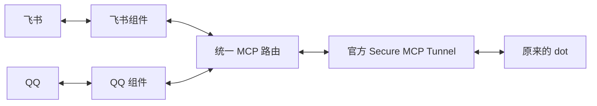

# DotBridge

把飞书和 QQ 接到你已有的 ChatGPT dot，用熟悉的聊天软件发消息，让同一个 dot 处理并回复。

这是 DotBridge 的统一安装与运行入口。你可以只启用飞书、只启用 QQ，或同时启用两者；各渠道继续由独立项目维护。

[English](README.en.md) · [安装与常驻运行](docs/operations.md) · [后续 IM 候选](docs/im-roadmap.md)

## 当前可用

| 渠道 | 使用方式 |
| --- | --- |
| 飞书 / Lark | 私聊文字、图片、文件和语音转写；其他交互按飞书组件的配置启用 |
| QQ 官方机器人 | 本人私聊文字和语音转写 |

语音通过可用转写交给原 dot。语音本身能否直接进入模型，取决于 dot 的工具环境。本地 Whisper 转写需要另外安装 Linux 运行环境；QQ 自带参考转写时可直接使用。



图中是工具调用和回复通道；新消息通过原 dot 建立的事件订阅通知它。已有 dot 的记忆、工具和身份继续由原平台管理。

## 安装

需要 **Node.js >=24.15 且 <25**。Windows 可前台运行；Linux 可使用 systemd 常驻运行。

Windows 还需要已有的 Python 3，用于核验私有文件的 ACL。按[Windows 配置说明](docs/operations.md#windows-私有文件检查)设置解释器路径。

```bash
git clone https://github.com/Arcueid77/dot-bridge.git
cd dot-bridge
npm ci --omit=dev --ignore-scripts --no-audit --no-fund
npm run bridge -- channels
```

本仓库已经包含所需组件的固定构建包，安装时不需要另行克隆飞书、QQ 或 core 仓库。当前使用源码安装，尚未发布 npm registry 包。

## 接入已有配置

如果已经使用飞书或 QQ 桥，可以保留原配对文件、密钥、数据库和订阅，把环境文件的绝对路径交给总入口。迁移启动前，应先停止原来对应的收发进程。

下面以 Linux 上同时使用飞书和 QQ 为例。请以最终运行用户执行配置检查和前台运行：

```bash
npm run bridge -- init --config ./bridge.json --mode live --channels lark,qq --env-dir /var/lib/dot-bridge/private --data-dir /var/lib/dot-bridge
npm run bridge -- doctor --config ./bridge.json
npm run bridge -- run --config ./bridge.json --confirm-live
```

只用飞书时，将 `--channels lark,qq` 换为 `--channels lark`。未选中的渠道不会启动，也不需要准备它的凭据。

`init` 创建的是配置清单，里面只有文件路径；它不会创建或覆盖平台凭据。清单已存在时，直接编辑它。第一次接入请按[配置说明](docs/operations.md#首次接入)完成对应平台授权。

前台运行时按 **Ctrl+C** 停止。常驻运行请使用[systemd 安装说明](docs/operations.md#linux-常驻运行)。

## 常用操作

```bash
# 查看本地 MCP 连接
npm run bridge -- status --config ./bridge.json

# 生成待安装的 Linux 服务文件
npm run bridge -- service render --config ./bridge.json --output ./systemd-output

# 服务安装完成后
sudo node bin/dotbridge.js service start --config ./bridge.json --confirm-live
sudo node bin/dotbridge.js service stop --config ./bridge.json
sudo node bin/dotbridge.js service restart --config ./bridge.json --confirm-live
sudo node bin/dotbridge.js service status --config ./bridge.json
```

`doctor` 检查安装与私有配置，`status` 检查本地 MCP 目录。实际收发还需要官方 Tunnel 连通、原 dot 的有效订阅和对应 IM 的连接。

## 项目组成

| 项目 | 职责 |
| --- | --- |
| 本仓库 | 安装入口、渠道组合、运行管理、整套版本 |
| [dot-lark-bridge](https://github.com/Arcueid77/dot-lark-bridge) | 飞书接入与收发 |
| [dot-qq-bridge](https://github.com/Arcueid77/dot-qq-bridge) | QQ 接入与收发 |
| [dot-bridge-core](https://github.com/Arcueid77/dot-bridge-core) | 公共传输、MCP 路由、私有文件保护和语音处理 |

新增 IM 会使用新的独立仓库，再接入总发行版。候选列表与接入顺序见 [IM 扩展计划](docs/im-roadmap.md)；当前可启动的渠道以 `channels` 命令为准。

开发与版本维护见[开发说明](docs/development.md)。
