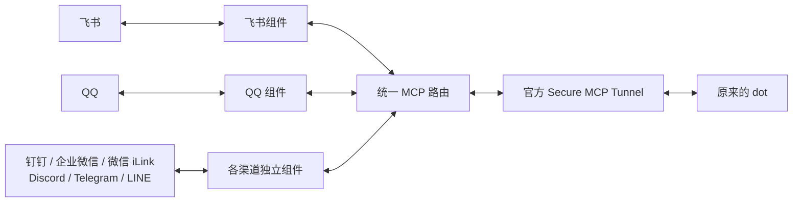

# DotBridge

把常用聊天软件接到你已有的 ChatGPT dot，用熟悉的聊天入口发消息，让同一个 dot 处理并回复。

这是 DotBridge 的统一安装与运行入口。按需启用飞书、QQ、钉钉、企业微信、微信 iLink、Discord、Telegram 或 LINE；各渠道由独立项目维护。

[English](README.en.md) · [安装与常驻运行](docs/operations.md) · [1.0 路线图](docs/im-roadmap.md)

## 当前可用

所有渠道默认处理本人私聊；飞书、Telegram 和 Discord 还可显式配置受控群聊与话题。回复回到原会话。图片、音频和文件通过附件工具读取；能否直接理解音频，还取决于 dot 的工具环境。

| 渠道 | 收到的内容 | 可以回复 |
| --- | --- | --- |
| 飞书 / Lark | 文字、图片、音频、文件 | 文字、图片、音频、文件 |
| QQ 官方机器人 | 文字、图片、音频、文件 | 文字、图片、原生语音、文件 |
| 钉钉 | 文字、图片、音频、文件 | 文字、图片、AMR 语音、文件 |
| 企业微信智能机器人 | 文字、图片、文件；语音使用平台提供的转写 | 文字、图片、AMR 语音、文件 |
| 微信 iLink | 文字、图片、音频、文件 | 文字、图片、原生语音、文件 |
| Discord | 文字、图片、音频、文件 | 文字、图片、可播放音频附件、文件 |
| Telegram | 文字、图片、音频、文件 | 文字、图片、语音、文件 |
| LINE | 文字、图片、音频、文件 | 文字；显式配置临时媒体下载入口后可回图片、语音 |

## 交互能力

| 能力 | 飞书 | QQ | 微信 iLink | Telegram | Discord |
| --- | --- | --- | --- | --- | --- |
| 处理反馈 | 表情／状态卡 | 原生输入提示 | 官方 typing | 表情／typing | 表情／typing |
| 渐进回复 | 同一卡片 | 原生流式 | 不提供 | 同一消息编辑 | 同一消息编辑 |
| 近期上下文 | 有 | 有 | 有 | 有 | 有 |
| 群／话题规则 | 可配置 | 本人私聊 | 本人私聊 | 可配置 | 可配置 |
| 本人管理命令 | 有 | 有 | 有 | 有 | 有 |

新群默认关闭。处理反馈、渐进回复和分段由各渠道受保护配置控制；只更新真实产生的文本。命令与原 dot 控制范围见[统一交互说明](docs/new-channels.md#统一交互与群聊规则)。

各平台的格式和大小限制见[渠道接入说明](docs/new-channels.md)。语音转写可作为参考；本地 Whisper 需要另外安装受保护的 Linux 运行环境。桥不会把一份转写标成“听到了原始语音”。

需要回发收到的附件时，可以直接告诉 dot“把这张图发回来”。桥会按原消息的附件编号读取和回复，不需要模型复制很长的编码文本。回复仍受各平台格式、大小和媒体配置限制。

TXT、Markdown、JSON、CSV 等文本附件会附带可阅读的文字摘录，支持 UTF-8 和带标记的 UTF-16；过长时明确显示为截断，原文件仍然保留。支持文件读取的渠道复用受保护的 Linux PDF／Office 摘录；未配置处理环境时保留原件和普通文本摘录。

飞书媒体需要在原交互配置中启用，并由应用管理员开通对应权限；详见飞书组件的配置说明。

钉钉、企业微信、微信、Discord 和 Telegram 的长回答会在超过平台单条文字上限时，以完整文本文件发回。LINE 在同一次回复中分段显示长文字；媒体下载入口默认关闭，也没有通用文件消息。语音回复使用已有录音，桥不自动把文字合成为语音。



图中是工具调用和回复通道；新消息通过原 dot 建立的事件订阅通知它。已有 dot 的记忆、工具和身份继续由原平台管理。

## 安装

需要 **Node.js >=24.15 且 <25**。Windows 可前台运行；Linux 可使用 systemd 常驻运行。

Windows 还需要已有的 Python 3，用于核验私有文件的 ACL。按[Windows 配置说明](docs/operations.md#windows-私有文件检查)设置解释器路径。

```bash
git clone https://github.com/Arcueid77/dot-bridge.git
cd dot-bridge
npm ci --omit=dev --ignore-scripts --no-audit --no-fund
npm run bridge -- channels
npm run bridge -- guide --channels telegram
```

本仓库已经包含所需组件的固定构建包，安装时不需要另行克隆各渠道或 core 仓库。当前使用源码安装，尚未发布 npm registry 包。

## 接入已有配置

如果已经使用飞书或 QQ 桥，可以保留原配对文件、密钥、数据库和订阅，把环境文件的绝对路径交给总入口。迁移启动前，应先停止原来对应的收发进程。

下面以 Linux 上同时使用飞书和 QQ 为例。请以最终运行用户执行配置检查和前台运行：

```bash
npm run bridge -- init --config ./bridge.json --mode live --channels lark,qq --env-dir /var/lib/dot-bridge/private --data-dir /var/lib/dot-bridge
npm run bridge -- doctor --config ./bridge.json
npm run bridge -- run --config ./bridge.json --confirm-live
```

只用飞书时，将 `--channels lark,qq` 换为 `--channels lark`。未选中的渠道不会启动，也不需要准备它的凭据。

`init` 创建的是配置清单，里面只有文件路径；它不会创建或覆盖平台凭据。清单已存在时，直接编辑它。第一次接入请按[配置说明](docs/operations.md#首次接入)完成对应平台授权。

前台运行时按 **Ctrl+C** 停止。常驻运行请使用[systemd 安装说明](docs/operations.md#linux-常驻运行)。

## 常用操作

```bash
# 查看绑定、网关连接和订阅状态
npm run bridge -- status --config ./bridge.json

# 生成待安装的 Linux 服务文件
npm run bridge -- service render --config ./bridge.json --output ./systemd-output

# 服务安装完成后
sudo node bin/dotbridge.js service start --config ./bridge.json --confirm-live
sudo node bin/dotbridge.js service stop --config ./bridge.json
sudo node bin/dotbridge.js service restart --config ./bridge.json --confirm-live
sudo node bin/dotbridge.js service status --config ./bridge.json
```

`guide` 列出各平台的接入步骤，`doctor` 检查安装与私有配置，`status` 分别显示网关和订阅状态。订阅失败时，新渠道会记录最近一次失败的阶段，方便判断下一步该处理什么。实际收发还需要官方 Tunnel 连通和原 dot 的有效订阅。

## 本机管理界面

在浏览器中查看八渠道连接进度、本人配对与原 dot 订阅步骤，保存下次启动使用的渠道，并检查本机已有发行版：

```bash
node bin/dotbridge.js ui --config /var/lib/dot-bridge/bridge.json
```

打开命令显示的本机地址。先看演示可以使用 `node bin/dotbridge.js ui --demo`，不会连接账号。界面不接收密钥或身份值，不自动启动第二套消费者；配置保存、备份与升级安排见[本机管理说明](docs/management.md)。

## 项目组成

| 项目 | 职责 |
| --- | --- |
| 本仓库 | 安装入口、渠道组合、运行管理、整套版本 |
| [dot-lark-bridge](https://github.com/Arcueid77/dot-lark-bridge) | 飞书接入与收发 |
| [dot-qq-bridge](https://github.com/Arcueid77/dot-qq-bridge) | QQ 接入与收发 |
| [dot-dingtalk-bridge](https://github.com/Arcueid77/dot-dingtalk-bridge) | 钉钉接入与收发 |
| [dot-wecom-bridge](https://github.com/Arcueid77/dot-wecom-bridge) | 企业微信智能机器人接入与收发 |
| [dot-weixin-bridge](https://github.com/Arcueid77/dot-weixin-bridge) | 微信 iLink接入与收发 |
| [dot-discord-bridge](https://github.com/Arcueid77/dot-discord-bridge) | Discord接入与收发 |
| [dot-telegram-bridge](https://github.com/Arcueid77/dot-telegram-bridge) | Telegram接入与收发 |
| [dot-line-bridge](https://github.com/Arcueid77/dot-line-bridge) | LINE接入与收发 |
| [dot-bridge-core](https://github.com/Arcueid77/dot-bridge-core) | 公共传输、MCP 路由、私有文件保护和语音处理 |

当前可启动的渠道以 `channels` 命令为准；[IM 扩展计划](docs/im-roadmap.md)记录后续方向。Slack 使用已有官方支持，不安排独立桥接组件。

开发与版本维护见[开发说明](docs/development.md)。

## 定时消息

可以让原 dot 把固定提醒发到另一个已绑定的本人私聊，也可以由原 dot 的定时任务生成内容后主动发送。主动发送默认关闭，按渠道单独启用。详见[定时消息使用指南](docs/scheduled-messages.md)。

QQ 也已接入本人主动文字和提醒；当前应用的主动消息资格及额度需先向平台核实。明确权限／额度拒绝会保留为 `rejected` 并暂停后续提醒，超时或未知结果保留 `uncertain`。
