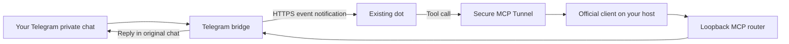

# Connect an IM account to DotBridge

[简体中文](getting-started.md) · [Home](../README.en.md)

This walkthrough connects your Telegram private chat to your existing dot using a Linux VPS. Other channels use the same Tunnel and subscription stages after their platform setup.

Examples use `/opt/dot-bridge/app` for code, `/var/lib/dot-bridge` for data and `dot-bridge` as the service account. Existing deployments should follow [migration](operations.en.md) and retain their bindings, storage keys and databases.

## 1 Check account access

Follow the [official Secure MCP Tunnel guide](https://developers.openai.com/api/docs/guides/secure-mcp-tunnels). Creating a tunnel needs organization-level Tunnels Read + Manage. The runtime and app operator need Read + Use. Associate the tunnel with the workspace containing your dot and confirm that workspace permits custom MCP plugins.

For owner-private use, restrict Tunnel use to your intended caller and keep the plugin personal.



The official client initiates outbound HTTPS. A subscription notifies dot about messages. Tool calls read messages and send replies through the Tunnel.

## 2 Install and prepare directories

Install Node.js `>=24.15` and `<25`, OpenSSL, and the selected source/release package at `/opt/dot-bridge/app`. It should contain `package.json`, `package-lock.json` and `vendor/`. Follow any required outbound proxy policy and retain TLS verification.

```bash
cd /opt/dot-bridge/app
node --version
umask 022
npm ci --omit=dev --ignore-scripts --no-audit --no-fund
```

An administrator creates the service account and private directories on a new host.

```bash
id dot-bridge >/dev/null 2>&1 || useradd --system --user-group --home-dir /var/lib/dot-bridge --shell /usr/sbin/nologin dot-bridge
install -d -m 0700 -o dot-bridge -g dot-bridge \
  /var/lib/dot-bridge /var/lib/dot-bridge/private \
  /var/lib/dot-bridge/private/keys /var/lib/dot-bridge/private/tunnel \
  /var/lib/dot-bridge/telegram /var/lib/dot-bridge/locks
```

Run subsequent `runuser` commands from the administrator terminal. Node must be accessible to the service account. Keep installed code and dependencies readable and read-only to that account. Windows users can follow the [Python and private ACL instructions](operations.en.md) and use their own absolute paths for pairing and foreground startup.

## 3 Create and pair a Telegram Bot

Create a dedicated Bot with the official [BotFather](https://t.me/BotFather). Save its Token alone in a new `/var/lib/dot-bridge/private/telegram.bot-token` file using a trusted editor. Set its owner to `dot-bridge:dot-bridge` and mode to `0600`.

With any old consumer stopped, run this from the distribution directory.

```bash
runuser -u dot-bridge -- node node_modules/dot-telegram-bridge/scripts/pair-owner.js \
  --token-file /var/lib/dot-bridge/private/telegram.bot-token \
  --credentials-file /var/lib/dot-bridge/private/telegram.credentials.json \
  --confirm-stopped --confirm-private-storage
```

Send the exact `/start db_…` command printed by the terminal to your Bot from your own Telegram account within two minutes. Continue after the binding file is saved. Resolve existing webhook, competing-consumer or pending-update issues before pairing. See [owner pairing](https://github.com/Arcueid77/dot-telegram-bridge/blob/main/docs/setup.md).

## 4 Configure the bridge

The platform Token, per-channel service key, aggregate service key, storage key and Tunnel runtime key have separate purposes. Keep them in protected files. Retain storage keys across updates.

Generate three independent keys for this new installation. Existing destination files cause the command to stop.

```bash
runuser -u dot-bridge -- node --input-type=module <<'JS'
import {randomBytes} from 'node:crypto';
import {writeFileSync} from 'node:fs';
const keys = [
  ['telegram-service-key', 'base64url'],
  ['telegram-storage-key', 'base64'],
  ['aggregate-service-key', 'base64url']
];
for (const [name, encoding] of keys) {
  writeFileSync('/var/lib/dot-bridge/private/keys/' + name,
    randomBytes(32).toString(encoding), {mode: 0o600, flag: 'wx'});
}
JS
```

Save `/var/lib/dot-bridge/private/telegram.env`.

```dotenv
AUTH_MODE=tunnel-service
BRIDGE_MODE=tunnel
TUNNEL_SERVICE_OPERATION=live
TUNNEL_SERVICE_OWNER_ID=tunnel-owner:dot-bridge
HOST=127.0.0.1
PORT=8794
TUNNEL_SERVICE_KEY_FILE=/var/lib/dot-bridge/private/keys/telegram-service-key
TELEGRAM_CREDENTIALS_FILE=/var/lib/dot-bridge/private/telegram.credentials.json
STORAGE_KEY_FILE=/var/lib/dot-bridge/private/keys/telegram-storage-key
DATABASE_PATH=/var/lib/dot-bridge/telegram/bridge.sqlite
BRIDGE_LOCK_DIRECTORY=/var/lib/dot-bridge/locks
CALLBACK_TRANSPORT_MODE=standard
CALLBACK_HOSTS=
```

Save `/var/lib/dot-bridge/private/router.env`.

```dotenv
AUTH_MODE=tunnel-service
BRIDGE_MODE=tunnel
TUNNEL_SERVICE_OPERATION=live
TUNNEL_SERVICE_OWNER_ID=tunnel-owner:dot-bridge
HOST=127.0.0.1
PORT=8789
TUNNEL_SERVICE_KEY_FILE=/var/lib/dot-bridge/private/keys/aggregate-service-key
```

Both files belong to `dot-bridge` with mode `0600`. Use available loopback ports. The manifest supplies the upstream list. Leave CALLBACK_HOSTS empty until the real subscription provides its hostname.

```bash
runuser -u dot-bridge -- node bin/dotbridge.js init \
  --config /var/lib/dot-bridge/bridge.json --mode live --channels telegram \
  --env-dir /var/lib/dot-bridge/private --data-dir /var/lib/dot-bridge
runuser -u dot-bridge -- node bin/dotbridge.js doctor --config /var/lib/dot-bridge/bridge.json
runuser -u dot-bridge -- node bin/dotbridge.js run \
  --config /var/lib/dot-bridge/bridge.json --confirm-live
```

Keep this running in terminal A. A waiting-for-subscription state leads into the following steps.

## 5 Start the official Tunnel client

Download the appropriate binary from the [official client releases](https://github.com/openai/tunnel-client/releases/latest) and install it at `/opt/dot-bridge/bin/tunnel-client` with mode `0755`. Read `tunnel-client help quickstart`. Use your own Tunnel ID and a restricted runtime key saved at `/var/lib/dot-bridge/private/tunnel/runtime-api-key`, owned by `dot-bridge` with mode `0600`.

Save this private profile at `/var/lib/dot-bridge/private/tunnel/profile.yaml`, with the same owner and file mode.

```yaml
config_version: 1
control_plane:
  base_url: https://api.openai.com
  tunnel_id: REPLACE_WITH_YOUR_TUNNEL_ID
  api_key: file:/var/lib/dot-bridge/private/tunnel/runtime-api-key
  poll_channels: [main]
mcp:
  server_urls:
    - channel: main
      url: http://127.0.0.1:8789/mcp
  extra_headers:
    X-Dot-Bridge-Service-Key: file:/var/lib/dot-bridge/private/keys/aggregate-service-key
log:
  level: info
  format: json
health:
  listen_addr: 127.0.0.1:0
admin_ui:
  open_browser: false
```

The `main` target points to the aggregate router. Its Header references the aggregate service key. In terminal B, check and run the client while terminal A remains active.

Use one client instance for this Tunnel's `main` channel. Review the current profile and process before switching an existing connection.

```bash
runuser -u dot-bridge -- /opt/dot-bridge/bin/tunnel-client doctor \
  --config /var/lib/dot-bridge/private/tunnel/profile.yaml --explain
runuser -u dot-bridge -- /opt/dot-bridge/bin/tunnel-client run \
  --config /var/lib/dot-bridge/private/tunnel/profile.yaml
```

## 6 Connect the plugin and subscribe

In the same ChatGPT workspace as your existing dot, open Plugins, add a custom MCP server and choose Connection → Tunnel. Select this Tunnel. This example uses the bridge service-key Header injected by the client and connects without OAuth. Review the prompts and create a personal plugin. See the [official connection guide](https://developers.openai.com/api/docs/guides/custom-mcp-server).

Confirm that tools include `check_telegram_readiness`, `get_telegram_message` and `reply_to_telegram`. Ask the original dot to reuse its existing Telegram event task or create one `telegram.message.created` subscription scoped to `conversation=owner`, read through `get_telegram_message` and reply once through `reply_to_telegram` in the original chat.

The callback comes from dot's real subscription. If approval is required, inspect its exact hostname, add it to CALLBACK_HOSTS, retain the environment file's service-user ownership and `0600` mode, gracefully restart the bridge in terminal A and finish the subscription. Preserve standard HTTPS and TLS verification.

Send a new private message from your paired account and confirm a reply, then send another different message. Dot/the platform renews the subscription according to its returned expiry. Keep the runtime host online.

## 7 Keep both processes running with systemd

Gracefully stop terminals A and B. Render the bridge units with the same installation and account.

```bash
runuser -u dot-bridge -- node bin/dotbridge.js service render \
  --config /var/lib/dot-bridge/bridge.json \
  --output /var/lib/dot-bridge/systemd-plan
```

The administrator reviews `dot-bridge-telegram.service`, `dot-bridge-router.service` and `dot-bridge.target`, including their absolute Node and program paths. Inspect an existing service before replacing it. For a new installation, install the reviewed units and a separate `dot-bridge-tunnel.service`.

```ini
[Unit]
Description=DotBridge official Secure MCP Tunnel
Wants=network-online.target dot-bridge-router.service
After=network-online.target dot-bridge-router.service

[Service]
Type=simple
User=dot-bridge
Group=dot-bridge
ExecStart=/opt/dot-bridge/bin/tunnel-client run --config /var/lib/dot-bridge/private/tunnel/profile.yaml
Restart=on-failure
RestartSec=5s
TimeoutStopSec=45s
UMask=0077
NoNewPrivileges=true
PrivateTmp=true
ProtectSystem=strict
ReadWritePaths=/var/lib/dot-bridge
LimitCORE=0

[Install]
WantedBy=multi-user.target
```

After installing the reviewed units, load the configuration and enable both services.

```bash
systemctl daemon-reload
systemctl enable --now dot-bridge.target
systemctl enable --now dot-bridge-tunnel.service
```

Disconnect the deployment SSH session and confirm another private reply. The VPS systemd services own the runtime. See [installation and updates](operations.en.md) for the full service and migration rules.

## Management and other channels

Run `node bin/dotbridge.js ui --config /var/lib/dot-bridge/bridge.json --port 5399` as the service user. Forward the same port with `ssh -N -L 5399:127.0.0.1:5399 YOUR_SERVER`, then open `http://127.0.0.1:5399`. See [management](management.en.md).

For another IM, replace the platform/pairing stage, use its own environment template, prepare separate keys and a data directory, add the channel to the manifest and subscribe to `<channel>.message.created`. Lark and QQ retain their native configuration templates. The [channel guide](new-channels.en.md) links platform instructions. LINE requires a public HTTPS webhook for inbound events. Installed component instructions are also available under their `node_modules/<package>/docs` directories.

If tools appear but messages receive no reply, inspect the original event task and callback hostname. For a missing Tunnel, check workspace association and Read/Use permissions. For private-file errors, check the runtime account, modes and links. Telegram polling conflicts call for coordinating the previous consumer/webhook. Keep current data and storage keys during [updates and rollback](operations.en.md).
